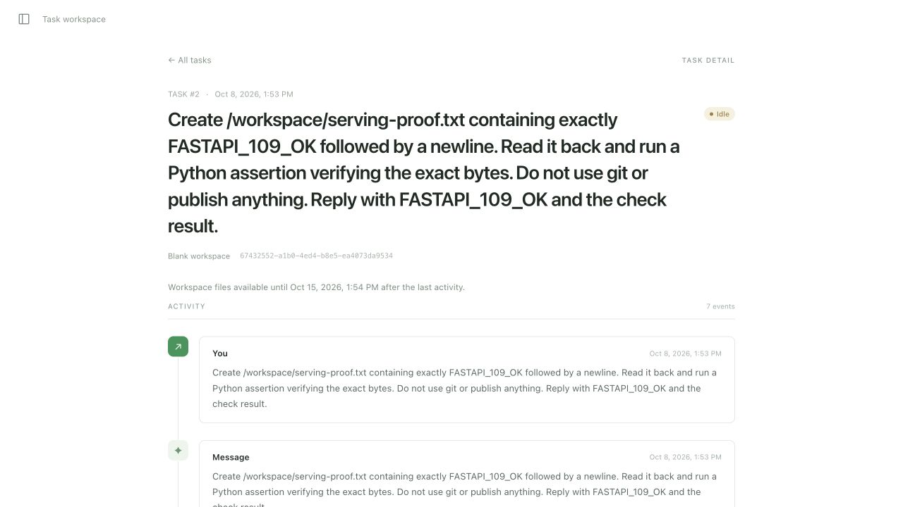

# Tarefas 109–111 — React/FastAPI e runtime Modal (2026-10-08)

Worktree `091-sqlite-modal`, branch homônima. Implementação concluída e prova
isolada aprovada; isto não é o corte de produção nem o onboarding público 123.

## Código e verificação automatizada

- FastAPI entrega `GG_WEB_DIST_PATH` depois das rotas HTTP/WebSocket. Prefixos
  API/auth/webhook/health/ready não entram no fallback. Traversal, dotfiles,
  assets ausentes e symlink para fora do build retornam erro. HTML usa
  `no-store`; assets usam `no-cache`; respostas auth/tasks usam `no-store`.
- `GG_WEB_ORIGIN` é obrigatório para serving. URLs de callback já usavam esta
  origem; redirects gerados pelo framework agora também a usam. Host público e
  X-Forwarded-Host forjados são rejeitados. O dialeto RFC Forwarded não é aceito.
- Modal substitui Host pelo endereço privado do container, sem fornecer
  X-Forwarded-Host. Só o wiring Modal habilita esse transporte, exigindo Host IP
  privado na porta 8000 e peer privado; Uvicorn não interpreta proxy headers.
  O transporte nunca determina a origem de callbacks/redirects. Teste cobre
  peer público e hostname forjado. Header forwarded forjado no proxy real
  retornou 400; a prova local cobre os demais formatos.
- Removidos server.ts/server.test.ts/tsconfig.server.json, scripts start e
  test:server, target Makefile start e configuração Railway do frontend. Vite
  mantém apenas seu proxy de desenvolvimento. HTTP/cookies permanecem relativos.
- Modal Server `gg-runtime`: min/max=1, buffer=0, nenhum target de autoscaling,
  Uvicorn workers=1, sem reload; proxy público, API autenticada pela aplicação.
  Volume v1 `gg-runtime-state`, Secret `gg-runtime-config`. Banco WAL ativo no
  disco local temporário; snapshot validado restaurado antes do socket/listen.
  Coordenador recebe `Volume.commit.aio`; lifespan existente salva dirty a cada
  dois segundos e drena scheduler/supervision antes do checkpoint final.
- Imagem compila React e remove executáveis Node após o build. `GG_MODAL_ENVIRONMENT`
  permite ao runtime isolado usar a imagem/sandbox publicados no ambiente main.

QA executada na ordem exigida: format-fix, lint-fix, format-check, lint-check,
pre-commit e unit-tests. **368 passed, 78 skipped, 2 deselected** em cada execução
final da suite. Skips legados por Postgres/serviços externos continuam fora desta
entrega, previstos em 113–118. Testes focados static_web + modal_runtime:
**11 passed**. Frontend: **15 passed**, build Vite aprovado. Builds SDK/backend/
sandbox aprovados. `git diff --check` aprovado. Logs locais:
`/tmp/gg-109-{qa-final2,focused,frontend,build}.log`.

## Demo local pelo frontend, sem servidor Node

FastAPI em `http://127.0.0.1:8003`, build real em `frontend/dist`, dispatch=true,
capacidade um. Serviços anteriores foram preservados. Reutilizada uma cópia
isolada do snapshot e das chaves do demo 108; sessão Google existente permaneceu
válida, sem criar novo login ou alterar callbacks externos. A skill local-stack
foi usada para exigir atividade/resultado/reserva; sua orientação antiga de
Postgres/chave administrativa cede à especificação SQLite/sessão Google.

Pela UI, enviada a task `67432552-a1b0-4ed4-b8e5-ea4073da9534`, workspace vazio,
modelo `z-ai/glm-5.3-flashx`. Criou `/workspace/serving-proof.txt`, leu os bytes e
executou uma asserção do conteúdo `FASTAPI_109_OK\n`. UI mostrou sete eventos e
resposta confirmando a asserção. Manifest `succeeded`, evidence_complete=true.
Reload e reinício central preservaram sessão, histórico e resposta. Nenhum git,
push ou PR neste demo. Deep links e assets também testados via HTTP/testes.

Após autorização explícita de limpeza, apenas o relógio de atividade da task
isolada foi avançado 46 minutos; fluxo normal sleep/sync/terminate liberou a
reserva: **sleeping, reserved=0**. Não se alterou o resultado do agente.



## Deploy e restauração reais no Modal

Ambiente novo `sqlite-111-proof`, banco explicitamente inicializado do zero,
sem importar usuários, sessões ou ciphertext de produção.
URL descoberta no deploy:
https://giordanowrk-sqlite-111-proof--gg-runtime-runtime.us-east.modal.direct
App `ap-o24JByeCYih7lQuCqIA6gl`, deployment final v5.

Comando de publicação suportado:

```sh
uv run --no-editable python -m gg.runtime.modal_runtime --environment sqlite-111-proof
```

Entrypoint usa `app.deploy(strategy="recreate")`. Alteração somente do Secret
pode fazer deploy sem código ser ignorado; nesse caso foi usado explicitamente:

```sh
uv run --no-editable modal app rollover gg-runtime --strategy recreate --env sqlite-111-proof
```

Não usar estratégia rolling, incluindo rollback/rollover operacionais. Modal
[documenta recreate como término dos containers antes do novo trabalho](https://modal.com/docs/guide/managing-deployments).
Inspeção durante builds pode listar um container de imagem além do runtime;
a inspeção final mostrou um único container runtime
`ta-01M4ENEZ34CH1DCTFWTD2HBZ2R`, um banco ativo e um processo Python Modal com
Uvicorn em thread, sem processo worker filho e sem Node (`which(node)=None`).
Logs mostraram shutdown/lifespan completos antes da abertura do container novo.
Não se presume lock local distribuído: exclusividade depende de recreate.

Task administrativa pública: `b5e7fa79-28d2-46a6-8d93-d65b02d1f72d`, chave
idempotente `modal-111-proof-v1`, sem repo. Sandbox
`sb-AveSIGHJZHsUAdzkZztDZL`, execução `b3c8e86a2a49353b6288ab6d781e9aca`, conversa
`c65cedac-b1ae-4429-a8a9-4a4bf5e2039c`. Criou o arquivo
`/workspace/modal-runtime-proof.txt` com `MODAL_111_OK\n`; eventos mostram comando
Python e observação `ASSERTION PASSED`, seguidos da resposta final que cumpre o
pedido. Dez eventos, manifest `succeeded`, evidence_complete=true; estado do
workspace `idle`. `check_status=not_run` refere-se ao check formal do supervisor;
a asserção pedida foi realmente executada por Pi, não se afirma CI completo.

Recreate do servidor central após execução, download e validação do snapshot
revisão 408 e replay público retornaram a mesma task/result/eventos. Snapshot
confirmou uma task, uma criação de sandbox, uma supervisão/execução, dez eventos.
Não foi criada mensagem follow-up (task_message_receipts=0). Após limpeza
explicitamente autorizada, relógio da task isolada avançado 46 minutos; fluxo
normal terminou sandbox/sleep: **sleeping, reserved=0**, snapshot revisão 468.

Health 200; deep link React 200; API inexistente 404; requests tasks sem chave
continuam autenticados pela aplicação. Secret recebeu somente a chave OpenRouter
real autorizada pelo usuário. As chaves locais do runtime isolado foram geradas
para o demo. Nenhuma credencial foi publicada em evidência.

Boundary: frontend local com sessão → FastAPI sem Node → Modal/Pi/OpenRouter →
atividade/check/manifest; URL Modal pública via API operacional → banco local →
Volume.commit → recreate → restore → replay e reserva liberada. Não foi feito
onboarding Google humano na URL pública: `GG_GOOGLE_CLIENT_ID/SECRET` não foram
provisionados neste ambiente (autorização apenas OpenRouter); `/auth/session`
retorna 503 JSON, jamais index.html. Esta prova continua na 123; medições e
crash abrupto/perda definitiva continuam na 124. O intervalo de checkpoint não
constitui SLA. Nenhum serviço de produção Railway/Supabase foi alterado.

Evidência bruta local: `/tmp/gg-111-proof/` (snapshot, eventos, manifest, resumo,
histórico, inspeção e confirmação de limpeza); logs `/tmp/gg-111-*.log`.
Arquivos de configuração com segredos têm permissão 0600 e não são anexados.

Ao final, encerrados somente o servidor local 8003 e o app `gg-runtime` no
ambiente `sqlite-111-proof`; Volume/Secret e provas preservados. URL acima é o
endpoint comprovado durante o demo, não um serviço de produção ativo. Verificação
final sem chave: `/tasks` 401 com `no-store`; `/tasks/` 404; `/auth/session` 503
com `no-store` por ausência de configuração Google pública.
