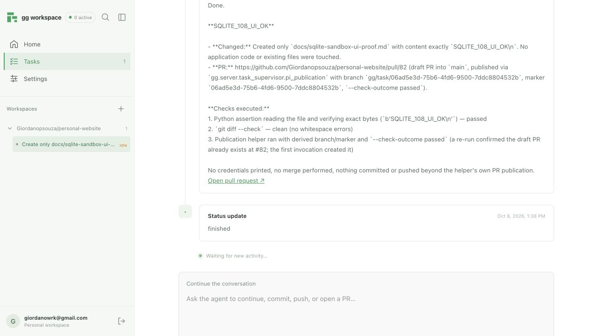

# Task 108 — imagem SQLite e demo real (2026-10-08)

**Status: concluída; aceite frontend com sessão Google/GitHub App comprovado.**

## Imagem e testes

Imagem publicada: `gg-agent-server:2026-10-08-sqlite-v1`, app
`gg-agent-sandboxes`, image ID `im-b38kpMB4OE83HopupJXgK1`.
Dockerfile verifica imports dos stores SQLite e CLI independente Pi com
`--state-db` dentro da imagem. Versões restantes preservadas. Capacidade do
produto permanece no máximo dez; o demo isolado usou um.

```sh
uv run --no-editable python -m gg.runtime.modal_image
GG_RUN_MODAL_TESTS=1 uv run --no-editable pytest \
  backend/tests/test_modal_sandbox_live.py -m modal
```

Build/publicação aprovados. Smoke live: **1 passed**; cria sandbox, verifica
health, cria conversa, persiste cinco mensagens, compara páginas de dois
com leitura completa, reconecta e encerra. O ledger do teste agora usa SQLite.
QA completa e builds: ver [106–107](../../docs/tasks/evidence/106-107-verification.md).

Fluxo de publicação conferido na [referência oficial Modal](https://modal.com/docs/guide/named-images).

## Prova inicial pela API operacional, com autorização para repo privado/Modal/OpenRouter

- Frontend/proxy Vite: `http://127.0.0.1:5174/`; runtime: `http://127.0.0.1:8002`.
  Serviços preexistentes em 5173/8001 preservados. Serviços deste demo parados ao final.
- Repo: `Giordanopsouza/personal-website`, base `main`.
- Task: `ff66c7fa-78ea-495f-9426-94d943712662`.
- Execução: `fa2d65832db6645030f2f572b7a70b4c`.
- Provider: `sb-advw6Yk9vFMRps9Pf24xx6`.
- [PR draft #81](https://github.com/Giordanopsouza/personal-website/pull/81).
  Um único arquivo novo `docs/sqlite-sandbox-proof.md`, conteúdo
  `SQLITE_108_OK` seguido de newline. Commit `a516b7c4a835a29dd11d4aa28f1c63ca645dc35b`.
  Nenhum merge.

Pi criou o arquivo, executou uma asserção Python de conteúdo exato e
`git diff --check`, depois publicou com o helper SQLite. A intenção persistida
registra `check_outcome=passed` e o SHA acima. O prompt incluiu `--title`, que o
helper não aceita; Pi corrigiu removendo esse argumento e publicou com sucesso.
A resposta final disse “nothing committed”, mas a inspeção GitHub prova um
commit criado pelo helper. A resposta também contém o marcador e a URL corretos.

Manifest arquivado: `agent_outcome=succeeded`, `evidence_complete=true`.
Seu `check_outcome=not_run` descreve o check formal do supervisor, que não foi
executado. Os dois checks pedidos foram executados por Pi e vistos nos eventos
HTTP e na intenção do helper; não se afirma aprovação de CI/aplicação completa.

Restart central ocorreu depois de atividade action real, durante a execução.
Repetir a admissão com a mesma idempotency_key retornou a mesma task. SQLite do
sandbox confirmou uma execução; histórico central tem 31 identidades de origem
únicas, cursors públicos 1–31 e uma única mensagem user. Consulta GitHub confirmou
uma única PR para o head/marker. Sleep sincronizou workspace, encerrou sandbox e
liberou a reserva: **reserved=0, pending=0**, dispatch ainda habilitado.

**Boundary provado:** HTTP via proxy frontend → API operacional → runtime SQLite
com dispatch → Modal/Pi/OpenRouter → arquivo/checks/PR draft → eventos e manifest
→ restart central/replay idempotente → reserva liberada. O demo não clicou na UI
nem utilizou sessão Google ou credenciais individuais GitHub App.

Evidência bruta local:
`/var/folders/np/k6zjxvqx6hj930xjq_kq9pnr0000gn/T/gg-108-repo.i9k44tba`.
Logs `/tmp/gg-108-repo-demo.log`, `/tmp/gg-106-108-modal-{build,smoke}.log`.
Script local `/tmp/gg-108-repo-demo.py`; lê token do keyring gh e credenciais do
environment sem imprimir valores. Nenhum segredo foi salvo no relatório.

## Prova completa pelo frontend com Google e GitHub App

Login Google e conexão GitHub App realizados pelo frontend local. Repo privado
`Giordanopsouza/personal-website`, branch `main`, selecionado na UI; tarefa enviada
pelo botão Spawn Task. O usuário autorizou o envio ao Modal/OpenRouter e o uso
da chave existente na conta local. A chave foi provisionada no vault nativo
SQLite, cifrada por proprietário, sem expor seu valor no navegador ou relatório.
Credenciais GitHub App locais foram obtidas do serviço existente; callbacks
Google/GitHub foram ajustados para a origem local. Não houve deploy em produção.

A spec prevaleceu sobre instruções antigas Postgres/chave administrativa da
local-stack: banco novo `/tmp/gg-108-ui/runtime.db`, snapshot local, sessão Google,
`GG_TASK_DISPATCH_ENABLED=true`, capacidade um e imagem publicada acima.
Runtime em 8002 e frontend em 5174 permanecem disponíveis para inspeção;
serviços preexistentes em 8001/5173 foram preservados. Chaves locais do vault e
cookie persistidas com permissão 0600 para sobreviver ao restart.

- Task: `06ad5e3d-75b6-4fd6-9500-7ddc8804532b`.
- Execução: `b1ce6081747d288d7d82c4706f8fd077`.
- Conversa: `446bfcba-674b-4e81-a540-e52859803b55`.
- Provider: `sb-oLMiFyqxJJN1lDV0w3dJiA`.
- [PR draft #82](https://github.com/Giordanopsouza/personal-website/pull/82), base `main`.
- Commit: `0b043a5886e6758a15f9648d018df29297f4f825`.
- Único arquivo alterado: `docs/sqlite-sandbox-ui-proof.md`, conteúdo exato
  `SQLITE_108_UI_OK` seguido de newline, confirmado no workspace remoto.

A UI mostrou atividade real, conclusão e resposta com marcador, URL e checks.
Pi executou asserção Python dos bytes e `git diff --check`; o helper persistiu
`check_outcome=passed`. Manifest: `agent_outcome=succeeded`,
`evidence_complete=true`. O check formal do supervisor não foi executado;
essa prova verifica os checks específicos pedidos, sem afirmar aprovação de CI.

Runtime reiniciado após quatro eventos action e 14 eventos totais. A sessão
Google permaneceu válida e a resposta apareceu após reload. Ledger central e
SQLite remoto confirmaram **uma execução, uma mensagem user, 16 eventos únicos**
(cursors públicos 1–16). Repetição do helper reutilizou a mesma PR #82; consulta
GitHub confirmou exatamente uma PR para o head, draft e somente o arquivo pedido.
O replay de admissão também foi comprovado na primeira prova operacional acima.

Para verificar liberação sem esperar 45 minutos, somente o relógio de última
atividade da tarefa isolada foi avançado em 46 minutos via escrita nativa do
ledger. O supervisor realizou seu fluxo normal de sleep/sync/terminate/release:
**state=sleeping, reserved=0, pending=0**. Não se simulou o resultado terminal.

**Boundary comprovado:** frontend com sessão Google → GitHub App/repo privado →
runtime SQLite com dispatch → Modal/Pi/OpenRouter → checks/PR draft → eventos,
resposta e manifest → restart sem duplicação → sincronização e reserva liberada.
Snapshot central local; durabilidade do banco central em Modal Volume não faz
parte deste demo e continua no escopo das tarefas posteriores.



Evidência bruta local (sem credenciais): `/tmp/gg-108-ui/ui-summary.json`,
`ui-events.json`, `ui-result.json`, `remote-verification.json`, `cleanup.json`.
Script de verificação `/tmp/gg-108-ui-verify.py`; logs
`/tmp/gg-108-ui-runtime-restart.log` e `/tmp/gg-108-ui-vite.log`.
Screenshot persistido neste diretório. QA do código: **357 passed, 78 skipped,
2 deselected**, sequência Makefile completa; testes focados **32 passed**,
builds dos três pacotes e smoke Modal **1 passed**. Alterações finais somente
em evidências/tracker; `git diff --check` executado novamente.
