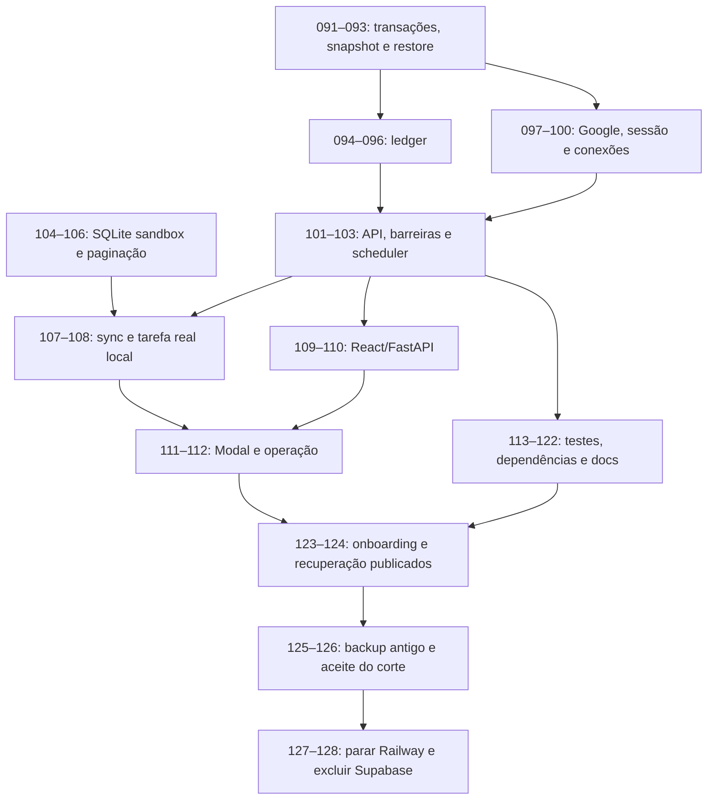

# Plano de implementação: SQLite e Google direto no Modal

Status: tarefas 091–096 implementadas e validadas localmente; 097–128 pendentes.
Data: 2026-10-07.
Worktree: `.agents/worktrees/091-sqlite-modal`.
Branch: `091-sqlite-modal`; base `2d1e2cc`.
Especificação integral: [spec.md](spec.md).

## Resultado esperado

Frontend React e API FastAPI na mesma URL HTTPS Modal, com SQLite local no runtime e nos sandboxes. Google OIDC direto aberto a qualquer conta válida, dados privados por usuário e banco novo. Preservar contratos de tarefas e limites atuais. Após tarefa real, recuperação, backup final restaurável e aceite do novo produto, parar Railway e excluir Supabase. Usuários antigos fazem novo login e reconectam GitHub/OpenRouter; nenhum dado antigo é importado.

## Tracker e escopo deste trabalho

O repositório declara `TRACKER_MODE: file` em [docs/tasks/README.md](../docs/tasks/README.md): um Markdown por tarefa, com `status:` como fonte de verdade. As tasks deste plano estão em `docs/tasks/091-*.md` até `128-*.md`. Não criar `tasks/todo.md` nem duplicar status em outro tracker. Este documento contém o índice ordenado e checkpoints. As tasks e o plano MVP existentes permanecem intactos.

A numeração 091 veio da especificação e era livre; 092–128 também estavam livres. O checkout principal contém alterações em config.py, conftest.py, skills-lock.json e arquivos de tasks não versionados. O worktree foi criado a partir do HEAD confirmado, sem copiar nem descartar essas alterações. Antes de implementar, conferir se alguma mudança local deve integrar esta iniciativa.

O usuário autorizou executar 091–093 em 2026-10-07. A fundação foi implementada na worktree indicada, com testes locais e commit simulado. A revisão humana do checkpoint permanece antes de avançar ao próximo grupo. Não houve deploy, criação de recurso cloud, mudança de credenciais, backup de produção ou desativação.

## Mapa do código conferido

| Superfície atual | Mudança planejada |
|---|---|
| `backend/gg/runtime/ledger.py` (~1750 linhas), `postgres.py`, `db_models.py` | sqlite3/SQL direto; portar famílias de operações em 094–096 |
| `web_auth.py`, `web_sessions.py` | Google OIDC + UUID por sub + sessão opaca no SQLite |
| `openrouter_vault.py`, `github_connection.py` | mesmo banco e coordenador de escrita; Fernet e autorização preservados |
| `scheduler.py`, `task_supervision/manager.py` | candidatos SQL; barreiras de intenção; páginas até 200 |
| `agent/event_log.py`, `agent/local_conversation.py`, `task_supervisor/store.py` | estado aplicativo em um DB por sandbox |
| `task_supervisor/pi_publication.py` | CLI independente do Pi também lê/grava intenção SQLite |
| `frontend/src/api.ts` | já usa same origin; preservar caminhos/cookies |
| `frontend/server/`, `tsconfig.server.json`, scripts npm | retirar servidor proxy de produção |
| `app.py`, `__main__.py`, `modal_image.py` | servir React; entrypoint Modal Server separado da imagem sandbox |
| `test_support/postgres_ledger.py`, `conftest.py` | fixtures por arquivo temporário, sem skips por falta de Postgres |
| Makefiles, Alembic/certificado, root npm e docs/skills locais | remover instruções e dependências ativas obsoletas |

README/Makefile citam `scripts/` e `supabase/` ausentes no checkout base. Inventariar arquivos realmente presentes antes de planejar remoções; não recriar ferramentas antigas só para apagá-las. A referência `.agents/references/definition-of-done.md` da skill não existe nesta instalação; usar o Definition of Done explícito de AGENTS.md e os critérios deste plano.

## Decisões de arquitetura

1. **Um escritor central.** Modal app `gg-runtime`, um Server, um processo Uvicorn sem reload, `min_containers=1`, `max_containers=1`. Manter capacidade dez sandboxes. Nenhum processo administrativo paralelo abre o DB ativo para escrita.
2. **SQLite central no disco local.** WAL/FULL/FK/timeout 10 s por conexão; SQL parametrizado; transações curtas. Tipos simples (UUID/sub/texto, inteiros, timestamps UTC e blobs Fernet) com constraints explícitas; não copiar schemas Postgres nem RLS como abstração.
3. **Schema incremental.** Migrações sequenciais com `PRAGMA user_version`, atômicas e verificadas. O schema nasce novo; migrações entre versões SQLite não importam o Postgres antigo.
4. **Uma revisão por commit.** Tasks, sessões, flows OAuth, usuários, instalações e credenciais usam o mesmo mecanismo de escrita. Revisão persistente na transação; distinguir commit local de revisão confirmada no Volume.
5. **Snapshot completo, um coordenador.** `sqlite3.backup()` → arquivo temporário fechado/validado → publicação → `Volume.commit()`. Capturar revisão contida no backup de forma consistente com seus dados. Liberar lock de escrita antes da espera de rede; nunca limpar dirty global ignorando escritas posteriores. Próximos waiters exigem snapshot que contenha sua revisão.
6. **Erro de persistência bloqueia efeito.** Mutações aguardam revisão durável, inclusive callbacks/logout/webhook. Falha retorna 503, mantém alteração local pendente e suspende novos efeitos; não alegar rollback após commit local. Definir retries de login/credencial/mensagem para evitar repetir troca OAuth ou efeitos de sucesso incerto.
7. **Recuperação antes de admissão.** Init explícito anterior ao primeiro deploy; restore normal falha fechado se snapshot ausente, inválido ou futuro. Reconciliar sandbox/reserva/run/mensagem/publicação com as identidades já confirmadas antes de abrir trabalho novo.
8. **Google direto.** Code+PKCE/state/nonce/browser binding, flow 10 min, consumo único. Validar assinatura/iss/aud/exp/nonce/email_verified; `sub` associa a UUID local. Sessão 7 dias: token aleatório no cookie e só hash no DB; revogação local. Nenhum refresh token Google é necessário para autenticar cada request.
9. **Ownership obrigatório.** Consultas limitadas ao owner autenticado, inclusive events/results/receipts/WebSocket/credentials/repos. Acesso administrativo explícito; não aceitar owner enviado pelo navegador como autorização. Fernet e versões de credencial preservadas, chaves no Secret.
10. **Sandbox separado.** Um DB por filesystem do sandbox, journal DELETE/FK/timeout, atomicidade execution_id/start_key. Nenhum import runtime↔server; `gg.sdk` mantém apenas contratos/clientes. Pi, repositórios e artefatos continuam arquivos. Restart do processo no mesmo sandbox não equivale a sobrevivência de um sandbox destruído.
11. **Eventos incrementais.** Endpoint mantém `list[Event]`; after exclusivo, limit opcional; omissão preserva leitura atual. Supervisor pede até 200, grava página+cursor por tarefa/conversa juntos, mantém dedup/limites. Contadores de tarefa e cursor persistem além da expiração; idempotência compacta mantém namespace por usuário.
12. **Mesma origem.** FastAPI monta assets/deep links depois das rotas reais. `web_origin` HTTPS configurada é autoridade para callback; header proxy só é aceito quando corresponde. Modal proxy público; autenticação/autorização continuam no app.
13. **Deploy recreate.** Nunca rolling para este escritor local. Medir interrupção e comprovar ausência de sobreposição em deploy/rollover/recuperação; lock de processo não é lock distribuído de Volume.
14. **Backup antigo offline.** Sem importação automática. Depois de aceitar dados novos, recovery/rollback usa checkpoints do novo produto e código compatível com seu schema.

## Entrega em fatias pequenas

091–093 entregam um demo de durabilidade isolado. 094–100 constroem o candidato central por famílias de operações, testadas diretamente; a troca de wiring ocorre na 101. O produto antigo publicado permanece operacional durante a construção. Preservar compatibilidade de interfaces na branch a cada fatia; se um port exigir mudar consumidores além do limite, subdividir antes de editar. Isso não cria uma plataforma de múltiplos bancos: `sqlite_ledger.py` é um arquivo de port temporário, incorporado a `ledger.py` na 101, que também elimina `web_sessions.py` após adotar `local_sessions.py`. Remover as dependências legadas na 118. Cada task exige teste ou demo que prove sua superfície.

Os grupos indicados em “arquivos” são alvos relacionados, não autorização para ampliar a task. Limite esperado: 3–5 arquivos; tarefas que revelarem mais trabalho se subdividem antes da implementação, atualizando dependências. 110 e 113–120 concentram remoções ou imports mecânicos; contabilizar arquivos reais, não esconder diff grande em glob. Comandos de testes novos são alvos propostos, criados junto à implementação.

## Dependências

## Índice de tarefas

### Fundação e durabilidade

- [091 — Transações SQLite do runtime](../docs/tasks/091-sqlite-transactions.md)
- [092 — Checkpoints por revisão](../docs/tasks/092-sqlite-checkpoints.md)
- [093 — Inicialização explícita do banco](../docs/tasks/093-sqlite-recovery-cli.md)

### Ledger de tarefas

- [094 — Admissão de tarefas SQLite](../docs/tasks/094-sqlite-task-admission.md)
- [095 — Identidades duráveis de execução](../docs/tasks/095-sqlite-task-effects.md)
- [096 — Evidência e retenção SQLite](../docs/tasks/096-sqlite-task-evidence.md)

### Login e cofre pessoal

- [097 — Usuários e sessões locais](../docs/tasks/097-sqlite-local-sessions.md)
- [098 — Login Google direto](../docs/tasks/098-google-direct-oidc.md)
- [099 — Cofre OpenRouter SQLite](../docs/tasks/099-sqlite-openrouter-vault.md)

### Runtime integrado

- [100 — Conexão GitHub SQLite](../docs/tasks/100-sqlite-github-connections.md)
- [101 — API local com Google e SQLite](../docs/tasks/101-sqlite-runtime-wiring.md)
- [102 — Barreiras antes de efeitos externos](../docs/tasks/102-durable-effect-barriers.md)

### Scheduler e estado do sandbox

- [103 — Consultas de candidatos do scheduler](../docs/tasks/103-sqlite-scheduler-candidates.md)
- [104 — Conversas SQLite no sandbox](../docs/tasks/104-sandbox-sqlite-conversations.md)
- [105 — Execuções SQLite no sandbox](../docs/tasks/105-sandbox-sqlite-executions.md)

### Sincronização e tarefa real

- [106 — Eventos do sandbox por cursor](../docs/tasks/106-sandbox-event-pagination.md)
- [107 — Sincronização incremental de eventos](../docs/tasks/107-incremental-event-sync.md)
- [108 — Imagem SQLite com tarefa real](../docs/tasks/108-sandbox-sqlite-live-demo.md)

### Mesma origem no Modal

- [109 — React servido pelo FastAPI](../docs/tasks/109-fastapi-react-serving.md)
- [110 — Remover proxy Node de produção](../docs/tasks/110-remove-node-production-proxy.md)
- [111 — Servidor único no Modal](../docs/tasks/111-modal-runtime-server.md)

### Operação e fixtures

- [112 — Comandos operacionais Modal](../docs/tasks/112-modal-state-operations.md)
- [113 — Testes unitários sem Postgres](../docs/tasks/113-sqlite-test-fixtures.md)
- [114 — Fixtures SQLite nos testes de API](../docs/tasks/114-sqlite-api-test-imports.md)

### Consumidores de testes

- [115 — Fixtures SQLite nos testes de dispatch](../docs/tasks/115-sqlite-scheduler-test-imports.md)
- [116 — Fixtures SQLite nos testes de supervisão](../docs/tasks/116-sqlite-auth-supervision-tests.md)
- [117 — Retirar harness de testes Postgres](../docs/tasks/117-remove-postgres-test-harness.md)

### Remoção de ferramentas legadas

- [118 — Remover dependências Postgres](../docs/tasks/118-remove-postgres-dependencies.md)
- [119 — Retirar revisões Alembic ativas](../docs/tasks/119-remove-alembic-revisions.md)
- [120 — Retirar ferramentas de banco antigas](../docs/tasks/120-remove-legacy-db-tooling.md)

### Documentação e onboarding publicado

- [121 — Registrar decisão SQLite](../docs/tasks/121-sqlite-architecture-record.md)
- [122 — Atualizar execução local](../docs/tasks/122-sqlite-local-runbook.md)
- [123 — Onboarding na URL Modal](../docs/tasks/123-modal-public-onboarding.md)

### Recuperação e corte

- [124 — Recuperação e medições no Modal](../docs/tasks/124-modal-recovery-measurements.md)
- [125 — Backup final do produto antigo](../docs/tasks/125-legacy-final-backup.md)
- [126 — Corte para o novo produto](../docs/tasks/126-modal-production-cutover.md)

### Desativação definitiva

- [127 — Parar serviços Railway](../docs/tasks/127-stop-railway-services.md)
- [128 — Excluir Supabase após aceite](../docs/tasks/128-remove-supabase-project.md)

## Checkpoints de revisão

### Após 91–93: Fundação e durabilidade

- [x] WAL, rollback, revisão do snapshot e recuperação fechada comprovados (37 testes focados).
- [x] QA e builds Python passaram; evidência nas tasks. Suite ampla: 258 passed, 92 skipped, 2 deselected; casos Postgres legados sem cobertura integral. Prova isolada sem wiring UI/runtime ou Volume real.
- [x] Usuário autorizou executar 094–096 em 2026-10-07 após o checkpoint 091–093.

### Após 94–96: Ledger de tarefas

- [x] Admissão, identidades externas, evidência e retenção passam contra SQLite (26 testes novos).
- [x] 63 testes focados 091–096; QA em ordem; builds Python aprovados. Suite ampla: 284 passed, 92 skipped, 2 deselected. Prova isolada no candidato, sem wiring UI/runtime (pré-requisito 101); evidência nas tasks.
- [x] Usuário autorizou executar 097–099 em 2026-10-08.

### Após 97–99: Login e cofre pessoal

- [x] Google/sessão/OpenRouter isolam dois usuários; confirmação aguarda checkpoint (30 testes novos).
- [x] QA em ordem e builds Python aprovados: 314 passed, 92 skipped, 2 deselected. Evidência nas tasks; prova candidata isolada/HTTP com Google e Modal simulados. E2E aguarda 101 (dependência 100), sem login humano/Volume real.
- [ ] Revisão humana antes do próximo grupo; Usuário autorizou executar 100–102 na worktree 091 em 2026-10-08; o código deste grupo foi implementado, com prova humana Google da 101 pendente.

### Após 100–102: Runtime integrado

- [x] GitHub/API em SQLite; cookies/ownership e barreiras verificados com provedores controlados; tarefa administrativa real no Modal, restart e mensagem idempotente aprovados.
- [ ] Login humano local de duas contas da 101: primeiro bloqueio `GG_GOOGLE_CLIENT_ID` ausente; detalhes nas [provas](../docs/tasks/evidence/100-102-runtime-verification.md).
- [x] Testes focados/build aplicável passam; 328 passed, 92 skipped, 2 deselected; fronteira e pré-requisitos nas provas.
- [ ] Revisão humana antes do próximo grupo; status sozinho não prova entrega.

### Após 103–105: Scheduler e estado do sandbox

- [x] Candidatos SQL; conversas e execução/helper Pi recuperam sem duplicação nos testes locais controlados.
- [x] Testes focados/build aplicável passam; [provas e limites](../docs/tasks/evidence/103-105-sqlite-sandbox-verification.md).
- [x] E2E Pi/Modal após autorização explícita: prompt cumprido, restart central e recriação no mesmo Volume, replay sem duplicação; reserva liberada (reserved=0, pending=0). Evidências e limites no registro 103–105.
- [ ] Revisão humana antes do próximo grupo; status sozinho não prova entrega.

### Após 106–108: Sincronização e tarefa real

- [ ] Cursor transacional; tarefa real local cumpre pedido, arquiva resultado e libera reserva.
- [ ] Testes focados/build aplicável passam; evidência nas tasks; registrar primeiro bloqueio e boundary exato.
- [ ] Revisão humana antes do próximo grupo; status sozinho não prova entrega.

### Após 109–111: Mesma origem no Modal

- [x] React/FastAPI e writer único; restore antes de admissão; recreate real e replay sem nova execução.
- [x] QA 368 passed/78 skipped/2 deselected; 11 focados, 15 frontend e builds aprovados; [provas](../docs/tasks/evidence/109-111-verification.md).
- [ ] Revisão humana antes do próximo grupo. Onboarding Google público ainda pertence à 123; nenhum corte de produção.

### Após 112–114: Operação e fixtures

- [ ] Comandos de estado/deploy e primeiros consumidores de testes sem serviços externos.
- [ ] Testes focados/build aplicável passam; evidência nas tasks; registrar primeiro bloqueio e boundary exato.
- [ ] Revisão humana antes do próximo grupo; status sozinho não prova entrega.

### Após 115–117: Consumidores de testes

- [ ] Dispatch/supervisão/auth testados com SQLite; helper Postgres removido.
- [ ] Testes focados/build aplicável passam; evidência nas tasks; registrar primeiro bloqueio e boundary exato.
- [ ] Revisão humana antes do próximo grupo; status sozinho não prova entrega.

### Após 118–120: Remoção de ferramentas legadas

- [ ] Dependências/ORM/Alembic/CLI Supabase retirados; builds e unit tests passam.
- [ ] Testes focados/build aplicável passam; evidência nas tasks; registrar primeiro bloqueio e boundary exato.
- [ ] Revisão humana antes do próximo grupo; status sozinho não prova entrega.

### Após 121–123: Documentação e onboarding publicado

- [ ] Docs correspondem ao código; duas contas e tarefa real na URL Modal.
- [ ] Testes focados/build aplicável passam; evidência nas tasks; registrar primeiro bloqueio e boundary exato.
- [ ] Revisão humana antes do próximo grupo; status sozinho não prova entrega.

### Após 124–126: Recuperação e corte

- [ ] QA completo, medições, backup restaurável e aceite humano registrados.
- [ ] Testes focados/build aplicável passam; evidência nas tasks; registrar primeiro bloqueio e boundary exato.
- [ ] Revisão humana antes do próximo grupo; status sozinho não prova entrega.

### Após 127–128: Desativação definitiva

- [ ] Railway parado, Supabase excluído e Modal funcionando.
- [ ] Testes focados/build aplicável passam; evidência nas tasks; registrar primeiro bloqueio e boundary exato.
- [ ] Revisão humana antes do próximo grupo; status sozinho não prova entrega.

## Definition of Done e provas

Para cada mudança de código, executar **em ordem**: `make format-fix`, `make lint-fix`, `make format-check`, `make lint-check`, `make pre-commit`, `make unit-tests`. Adicionar `make frontend-test` e `make frontend-build` em mudanças frontend/serving e checkpoints publicados. Instalação/comandos externos ao Makefile: `uv sync --no-editable` / `uv run --no-editable`. Não afirmar unit tests completos quando casos foram skipados por Postgres ausente.

| Requisito | Prova principal |
|---|---|
| Concorrência/rollback/migração/versão | 091, 093 |
| WAL no backup/escrita durante commit/falha de commit | 092, 093, 124 |
| FIFO/capacidade/idempotência por usuário/seq/retention | 094–096, 103 |
| Google callback válido/replay/expirado/token inválido/logout/isolation | 097–101, 123 |
| Cifra/versões/escopo de repo/sem segredos em resposta | 099–100, 123 |
| Intenção antes de efeito/recovery/sem duplicação | 095, 102, 105, 124 |
| Eventos por cursor/página atômica/evidência limitada | 106–107 |
| Sandbox reiniciado/resultado/Pi/PR sem duplicação | 104–108 |
| React/API/WS/cookies mesma origem | 109–111, 123 |
| Tarefa real local e publicada, repetida após restart | 108, 123–124 |
| Sem serviços externos para testes unitários | 113–118 |
| Comandos init/migrate/backup/restore/deploy | 093, 112 |
| Consultas, tráfego e latência com checkpoint | 103, 124 |
| Backup final Auth+app restaurável/sem import | 125 |
| Aceite → parar Railway → excluir Supabase | 126–128 |

A prova live usa frontend + gg.runtime com dispatch habilitado, credenciais individuais e imagem publicada. Requer atividade, resposta que cumpre o prompt, resultado manifest arquivado e reserva liberada; não basta `queued`, `succeeded` ou admission-only. Diferenciar restart central, processo sandbox e perda definitiva de filesystem. Em falha de pré-requisito, reportar o primeiro não atendido e o boundary testado, sem marcar E2E aprovado.

## Riscos e mitigação

| Risco | Impacto | Mitigação |
|---|---|---|
| Escritas fora do coordenador | Alto | Inventário de todos os stores; revision/checkpoint único e testes por mutação |
| Backup revision desalinhada ou dirty perdido | Alto | Revisão capturada com conteúdo; waiters por watermark; teste de escrita durante commit |
| 503 depois de commit local induz repetição | Alto | Documentar sucesso incerto, replay idempotente e estado de OAuth; não devolver confirmação antes de persistir |
| Volume não equivale a DB compartilhado | Alto | DB ativo local; arquivo de snapshot fechado; commit único; sem lock distribuído presumido |
| Dois escritores em replacement | Alto | recreate em todos os caminhos; prova de deploy/rollover com escrita; bloquear publicação se exclusividade não for comprovada |
| Histórico/retention reusa identidade | Alto | Contadores/registro compacto persistentes separados de payload expirável |
| Código extenso de ledger e tests acoplados | Médio | Port por famílias, testes de contrato e contagem de arquivos; subdividir 113/118 se necessário |
| Helper Pi ainda usa JSON/Path | Alto | Port explícito de CLI/consumidores na 105, smoke em imagem real |
| Local-stack atual exige Supabase/chave no navegador | Médio | Atualizar skill/runbook antes do demo 108; antecipar trecho necessário da 122 sem duplicar task |
| min_containers não impede crash/preemption | Alto | Restore fechado, reconciliação e checkpoints; teste de falha abrupta |
| Crescimento/tamanho de snapshots completos | Médio | Limites atuais + retenção; medir bytes e latência, escolher retenção de snapshots após medidas |
| Excluir Supabase sem backup Auth restaurável | Alto | Backup final após pausa; restore isolado e chaves separadas; exclusão depende de aceite registrado |
| Mudanças locais fora da base | Médio | Checkout principal preservado; conferir antes de port; não assumir alterações excluídas incorporadas |

O intervalo de dois segundos tenta salvar eventos de fundo; não é SLA de perda máxima sob falhas. Dados confirmados exigem checkpoint concluído. Recreate admite breve interrupção; não prometer disponibilidade contínua.

## Pré-requisitos e pontos a decidir durante a execução

Decisões de produto da especificação já estão fechadas. Não reabrir Google público, banco novo, Modal ou remoção final dos serviços antigos.

- Disponibilidade de credenciais Modal, Google OAuth client/secret externo, chaves Fernet, GitHub App/webhook e duas contas humanas para teste. Conferir presença/configuração sem imprimir valores; só acesso interativo de login pode exigir participação humana.
- URL pública real é descoberta no deploy; não inventar hostname. Configurar callbacks depois dessa descoberta e confirmar por read-back.
- Inventariar IDs exatos Railway/Supabase e destino privado do backup offline na 125. Aceite final do produto publicado deve ser registrado na 126.
- Retenção de snapshots: proposta inicial simples de snapshot atual mais anterior íntegro, sem remover o único restore validado. Confirmar quantidade/limite de disco após medir tamanho na 124; retenção de dados do produto continua a atual.
- Utilizar Volume v1 na primeira entrega como proposta conservadora; verificar API instalada Modal 1.5.5 e opções reais no início da 111. Não trocar versão implicitamente.
- Caso docs/SDK usados não comprovem escritor exclusivo em replacement, bloquear essa implantação e ajustar o mecanismo antes do corte, sem adotar lock local como solução distribuída.

## Paralelização possível

Depois de 091, sandbox 104–106 pode ser trabalhado independentemente de auth/ledger central. Após contratos 097/098, OpenRouter 099 e GitHub 100 podem avançar separadamente. Schemas/migrações, ledger compartilhado, wiring e corte devem ser sequenciais; coordenar edição dos mesmos arquivos antes de paralelizar. Este planejamento não iniciou subagentes nem novos chats.

## Fontes conferidas

- [SQLite WAL](https://www.sqlite.org/wal.html): WAL precisa de acesso no mesmo host.
- [Python 3.12 sqlite3](https://docs.python.org/3.12/library/sqlite3.html): backup e controle transacional devem considerar a versão Python do repo.
- [Modal Volumes](https://modal.com/docs/guide/volumes): commit/reload explícitos e evitar escritores concorrentes no mesmo arquivo.
- [Modal Servers](https://modal.com/docs/guide/servers): servidor nativo, URL pública, limites de containers e autenticação do proxy.
- [Modal deployment strategies](https://modal.com/docs/guide/managing-deployments): rolling sobrepõe versões; recreate permite substituição abrupta.
- [Google OpenID Connect](https://developers.google.com/identity/openid-connect/openid-connect): fluxo e validação da identidade.
- [Supabase backups](https://supabase.com/docs/guides/platform/backups): conferir cobertura do export/restore na operação final.

## Verificação deste plano

- [x] Especificação e superfícies atuais lidas; checkout principal preservado.
- [x] Worktree dedicado confirmado antes de qualquer documento criado.
- [x] Sem tasks/plan.md ou tasks/todo.md preexistentes sobrescritos; tracker atual preservado.
- [x] 38 tarefas com aceitação, prova, dependências, arquivos e escopo.
- [x] Checkpoints após grupos de duas ou três tarefas.
- [x] Riscos, dependências e primeiros fluxos locais/publicados identificados.
- [x] Usuário autorizou implementar 091–093, 094–096, 097–099 e 100–102 na worktree 091. Outros grupos aguardam autorização no respectivo checkpoint.

## Execução autorizada 100–102 (2026-10-08)

Worktree 091 reutilizada; preservar alterações anteriores. Fatias sequenciais:
- 100a: schema e store GitHub; 100b: rotas com checkpoint e isolamento/token de repo.
- 101a: incorporar ledger SQLite e remover stores substituídos/imports ativos;
  101b: lifespan, banco/coordenador compartilhados e barreiras HTTP;
  101c: testes API/cookies/WebSocket e compatibilidade dos testes anteriores.
- 102a: checkpoint antes de provisão/run/mensagem/publicação;
  102b: recuperação, readiness e checkpoint periódico;
  102c: injeção de falhas e identidades estáveis, QA e prova operacional.

As fatias limitam as edições por subsistema; a prova humana Google/Modal depende
 das credenciais locais, e falhas de pré-requisitos serão registradas.

## Execução autorizada 103–105 (2026-10-08)

Worktree 091 reutilizada, preservando mudanças anteriores. Fatias sequenciais:
- 103a: consultas de fila/expiração e índices; 103b: scheduler e provas SQLite
  de histórico volumoso, recuperação e planos de consulta.
- 104a: banco sandbox e stores de metadados/eventos/recibos;
  104b: catálogo/hidratação e testes de restart/HTTP.
- 105a: admissão e manifests SQLite (store/service/testes);
  105b: intenção SQLite no helper/CLI Pi e provas de conflito/timeout/replay;
  105c: QA agregado e prova operacional, registrando pré-requisitos ausentes.

Cada fatia limita as edições de implementação a cinco arquivos relevantes.
O banco sandbox fica em conversations_dir/sandbox.db e é compartilhado pelo
supervisor e helper. Arquivos nativos Pi e workspace permanecem no filesystem.
Não importar JSON legado: a especificação exige banco novo.

## Execução autorizada 106–108 (2026-10-08)

Worktree 091 reutilizada, inicialmente limpa. Implementação em fatias por superfície:
- 106a: EventLog SQL e propagação em LocalConversation/ConversationService (3 arquivos).
- 106b: parâmetros HTTP e prova de páginas/validação (2 arquivos).
- 107: migração 10, ledger, manager e duas suítes de testes (5 arquivos).
- 108a: nome de imagem versionado, Dockerfile e teste da imagem (3 arquivos).
- 108b: smoke live SQLite e demo API isolado com restart/PR draft.
- 108c: login Google/GitHub App, demo pelo frontend, restart e evidências finais.

106–108 concluídas. Imagem publicada, smoke live e QA aprovados. O demo pelo
frontend autenticado com Google/GitHub App produziu a PR draft #82, checks,
resposta útil e manifest. Restart preservou uma execução/mensagem/PR;
workspace encerrado com reserved=0 e pending=0. Ver
[106–107](../docs/tasks/evidence/106-107-verification.md) e
[108](evidence/108-sandbox-demo.md).

## Execução autorizada 109–111 (2026-10-08)

Worktree 091 confirmada e reutilizada. Fatias sequenciais, até cinco arquivos
de implementação por fatia:
- 109: serving/guard de origem, settings, wiring e testes HTTP/WS.
- 110a: scripts frontend e remoção dos três arquivos do proxy Node;
  110b: referências operacionais e prova com build real.
- 111a: imagem e servidor Modal com restore/commit e testes;
  111b: deploy isolado recreate, restart e provas operacionais.
QA em ordem, builds e demo real; registrar primeiro bloqueio sem declarar
aceite live quando algum pré-requisito não estiver disponível.

## Execução autorizada 112–114 (2026-10-08)

Worktree 091 reutilizada, inicialmente limpa. Fatias sequenciais:
- 113: helper SQLite, reexport, fixture autouse e provas de isolamento/reabertura.
- 114a: cinco consumidores API/SDK; 114b: correção de replay HTTP de payload
  expirado revelada pelo teste de ownership, preservando a identidade.
- 112a: endpoint operacional do coordenador e identificação de versão/revisão;
  112b: comandos Modal isolados e Makefiles; 112c: testes e demo operacional.
Cada fatia limita as edições por subsistema. Usar somente ambiente Modal isolado
para a prova operacional; não fazer o corte de produção das tarefas 125–128.

A troca do autouse na 113 fez executar casos antes pulados: três consumidores
legados (modal_sandbox, production_operations e runtime_latency) acessavam
_conn/_lock/engine Postgres. Antecipado somente o ajuste dessas operações de
fixture para SQLite, em uma fatia de três arquivos, para manter o QA verde.
Não concluir 115/116 por isso; o restante dessas tarefas conserva seu escopo.

112–114 concluídas: operações remotas isoladas com lease compartilhada,
backup ativo pelo coordenador, fixtures sem Postgres e contratos API/SDK
preservados. QA final: 456 passed, 3 skips de integração Postgres legada,
2 deselected; builds e testes frontend aprovados. Demo real no ambiente
sqlite-111-proof preservou identidade/eventos/manifest após restore e recreate;
recursos do ensaio encerrados, reserved=0. Ver
[evidência 112–114](../docs/tasks/evidence/112-114-verification.md).
